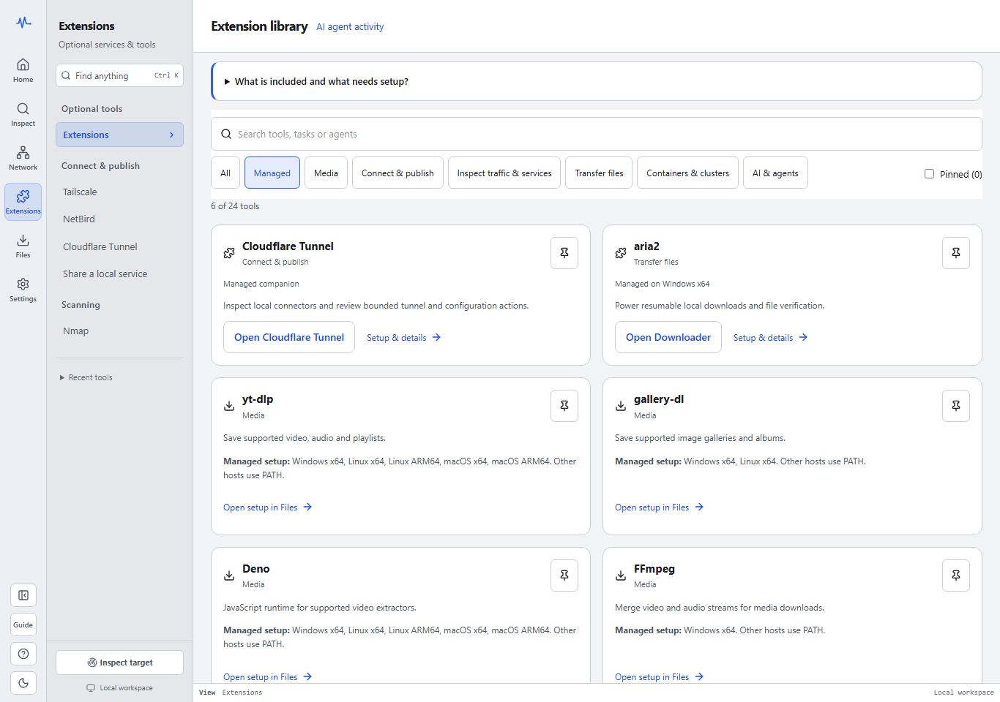

# Optional tools with Extensions

**Published v0.7.0:** Extensions contains **20 optional entries**: six native
workbenches and fourteen guides or links with explicit integration levels. It replaces
the Publish destination in the six-part layout: Home, Inspect, Network, Extensions, Files and
Settings. Older v0.6.1 binaries retain their earlier layout. Native-client, account and
independently promoted package acceptance remain separate from release availability.

## Start with what you need

Open **Extensions** at `/extensions`, search for a task or tool, and select one entry. Pin the
entries you use to keep them close in this library. Pins and manual setup-platform choices store
only catalog and platform IDs in this browser, without addresses, credentials, pairing data or results.

Opening the catalog does not inspect tools or load every detail pack. The selected entry’s
details load when you open it. Managed standalone entries check their own local installation status
on opening; this does not contact the network. Choose **Check this host** on a guided entry for one local availability observation.
It checks this process’s PATH and reviewed fixed locations without executing the selected tool.
aria2 may also read and verify an existing cached bundle checksum. Detection does not start a process,
scan, capture, sign-in flow, model download or service. Cancelling a slow check detaches the browser;
an OS filesystem lookup already waiting may still finish.

In current source, choose **Guide** to walk through the selected tool. The tour shows the controls and prerequisites for the tool you have open.
Current release recipes use the lightweight Windows x64 build. Install aria2 on demand or supply its
verified offline ZIP beside the executable. The release recipes attach the Windows aria2 ZIP separately under its expected name. A previously prepared v0.7.0 engine can be reused after verification. Published v0.7.0 embeds the fallback. The Store package builder pairs a lightweight Windows release with its verified offline ZIP inside the MSIX. This keeps the Store download usable offline when the app folder is read-only. See the
[offline build instructions](https://github.com/shreyam1008/ProtoPeek/blob/master/internal/bundledaria2/README.md#optional-windows-x64-lightweight-local-preview).

Setup applies to the **machine running ProtoPeek**, which may differ from the machine displaying
your browser. A remote server or container needs its own accessible tools. Guidance uses the host
operating system and points to official installation instructions.

## Manage a local companion (current source)



Current source has 37 library entries, including 20 managed companions. The **Media** filter opens yt-dlp, gallery-dl, Deno or FFmpeg directly in its Files setup. Standalone companions open their own setup, where you can review the source and download size, install, and copy a command to run them. Availability varies by operating system and architecture. Video setup shows its selected helpers and combined download size. Stop active media jobs before removal.

Open **Cloudflare Tunnel** or **aria2** in Extensions and check the companion status. Review the version and install size, then confirm installation. Cloudflared downloads on request from its pinned release on Windows x64, Linux amd64/arm64 and macOS amd64/arm64. Its local binary can inspect a connector; on Windows and Linux it can also power an explicitly started Quick Tunnel. Temporary publishing remains unavailable on macOS. Publishing a service is a separate action. On Windows x64, aria2 prepares the archive for Downloader. Lightweight builds can download the pinned archive on request or use a sidecar supplied for offline setup. Once installed, open the associated workbench. Stop active use before choosing **Remove companion**. If a cached aria2 archive changes, **Repair companion** preserves it in quarantine and downloads a verified replacement. Files offers **Repair setup** for a partial media installation when its remaining files can be verified.

The terminal uses the same local installation; status, install and remove return JSON:

```sh
pp extensions status --json
pp extensions status cloudflared
pp extensions install cloudflared
pp extensions remove cloudflared
```

Inventory covers all managed companions. Run a standalone tool with `pp extensions run grpcurl --help`, replacing `grpcurl` with its ID. This forwards the companion's input, output and exit status. Media installs can add missing supported helpers for yt-dlp. CLI media changes require the Files queue to be free. If the workbench owns the queue, use Files there or close the workbench before the CLI operation. A paired agent can inspect this inventory with `managed_tools`. These additions are in current source; use the published release instructions above when running v0.7.0.

To contribute a standalone companion, submit a pull request to the [community catalog](https://github.com/shreyam1008/ProtoPeek/tree/master/internal/communitytools). Its JSON Schema defines the entry format, and the contribution guide explains pinned packages, licensing and platform verification.

## Six native workbenches

**Native workbench** means a bounded operational adapter with its own evidence and action
controls. It does not prove that your installed tool, account, permissions or endpoint are ready.

| Group | Tool | What it enables | Existing workbench |
| --- | --- | --- | --- |
| Optional services | Tailscale | Installed-client peers, accounts, connection diagnostics, reviewed local controls and Taildrop | `/network/tailnet` |
| Optional services | Cloudflare Tunnel | Local `cloudflared` service, configuration and route evidence, with guarded service controls | `/tunnels` |
| Optional services | NetBird | Native installed-client evidence and bounded reviewed actions; account setup stays in NetBird | `/extensions/netbird` |
| Network tools | Wireshark capture | A bounded live capture through the installed `dumpcap` executable | `/network/packets?mode=live` |
| Network tools | Nmap | Bounded TCP connect or light service detection with explicit scope | `/network/nmap` |
| Transfers | aria2 | An optional engine for resumable HTTP(S) downloads and advanced connection settings | `/downloader` |

Open a card to see its requirements and supported actions. Install a managed companion through its setup controls. For a VPN client, capture driver or externally managed CLI, use the listed vendor installer or host package manager, then return to the entry and check the host.

## Fourteen guided entries

These v0.7.0 entries are setup and handoff paths, **not fourteen additional native adapters**.
Command examples are static text to review, copy and run yourself; opening a guide does not start
services or authenticate with vendors. Current source additionally offers an explicitly installed
managed Caddy CLI; its guide still works with an external installation on PATH.

| Entry | Integration level | Useful next step |
| --- | --- | --- |
| [Caddy](https://caddyserver.com/docs/install) | Command guide | Inspect existing loopback reverse-proxy upstreams through an unsent HTTP draft; no Caddy config writes |
| [ngrok](https://ngrok.com/download) | Command guide | Review a public endpoint recipe requiring your vendor account; no ProtoPeek-owned tunnel |
| [OpenSSH](https://www.openssh.org/portable.html) | Command guide | Start your own authorized loopback-only forward, then inspect its local HTTP endpoint |
| [Docker](https://docs.docker.com/get-started/get-docker/) | Command guide | Find an existing container’s host-mapped port, then prepare an HTTP request |
| [Podman](https://podman.io/docs/installation) | Command guide | Inspect your own container mapping; macOS/Windows also need their native Podman machine |
| [kubectl](https://kubernetes.io/docs/tasks/tools/) | Command guide | Review an authorized loopback port-forward; cluster/context/namespace stay user-owned |
| [OpenSSL](https://docs.openssl.org/master/man1/openssl/) | Command guide | Compare native certificate/TLS observations; built-in TLS diagnostics remain available |
| [Codex CLI](https://learn.chatgpt.com/docs/codex/cli) | MCP setup | Merge a generated local MCP fragment from AI agent setup |
| [Claude Code](https://code.claude.com/docs/en/mcp) | MCP setup | Merge the fragment, then review and approve `protopeek` in your trusted project |
| [Gemini CLI](https://geminicli.com/docs/tools/mcp-server/) | MCP setup | Merge the `mcpServers` fragment; if folder trust is enabled, trust your project before connecting |
| [OpenCode](https://opencode.ai/docs/mcp-servers/) | MCP setup | Merge the local command-array and `environment` fragment |
| [Ollama](https://docs.ollama.com/api/introduction) | Endpoint guide | Prepare an unsent loopback `/api/tags` request for your running local server |
| [LM Studio](https://lmstudio.ai/docs/developer/openai-compat) | Endpoint guide | Prepare an unsent loopback `/v1/models` request for your running local server |
| [ChatGPT web](https://help.openai.com/en/articles/11487775-connected-apps-in-chatgpt) | External link | Open a companion guide and fixed prompt containing no service evidence |

Every example endpoint is an **unsent draft**. Verify the actual host port before Send; a
forwarded, guest or container port can differ from its host mapping. **Never publish the Caddy
admin port or the Ollama/LM Studio model-server ports.** Caddy’s example reads
`GET /reverse_proxy/upstreams`, not the full `/config/` document. The guide does not create a
reverse proxy or change its configuration. Use the existing reviewed publishing workbench for
supported exposure operations, with its explicit audience and native acceptance requirements.

For AI clients, [pair the local workbench](ai-agents.md) through `127.0.0.1`, choose the client
format, and merge the generated fragment into its named configuration file. Do not replace
unrelated settings or paste a pairing token into chat. Formats were checked against vendor docs
on 23 October 2026; actual installed-client and account acceptance remain separate.

ChatGPT **web** does not read local Codex configuration, and this library supplies no direct
web stdio connector, hosted account or public MCP relay. Its fixed companion prompt contains no
addresses, headers or results. The Codex CLI entry covers the separate local stdio workflow;
ChatGPT web does not read that configuration. Ollama/LM Studio installation, model download/loading
and server startup are separate native actions; no model is downloaded by opening this library.

## Read the status accurately

| Status | Meaning |
| --- | --- |
| Not checked | No availability observation was requested for this entry. |
| Detected | An executable was found in a supported location. It has not been run by this check. |
| Included | This build supplies the tool as a fallback; another installation may take priority. |
| Not found | The named CLI was not found on this process’s PATH or the listed locations; this is not proof the application is uninstalled. |
| Unavailable | Detection could not be completed on this host. Read the reported reason. |

**Detected does not mean ready.** Tailscale can still need sign-in, a service can be stopped, and
dumpcap can lack capture permission. Open the relevant workbench for its actual capabilities and
observations. Installation detection and operational evidence remain separate.

Checks describe the CLI and locations searched. If you installed a tool after starting ProtoPeek,
restart ProtoPeek so its process receives the updated PATH, then check again. LM Studio checks
the `lms` CLI rather than declaring whether its desktop app is installed. ChatGPT web is an
external link and has no executable check.

Slow filesystem lookups share two slots, including the legacy six-tool API. A busy host check
returns HTTP `429` with retry guidance. Cancel stops waiting (`499`); a lookup already inside
the OS retains its slot until it returns. Static catalog metadata and ChatGPT’s external
guidance remain available without filesystem slots. On macOS, native workbenches retain their
own supported executable locations; keeping Homebrew’s `bin` directory on ProtoPeek’s PATH
lets the native tool and its availability check use the same command.

## Tailscale and Cloudflare Tunnel

Install Tailscale using its [official download page](https://tailscale.com/download) and the
[Windows](https://tailscale.com/docs/install/windows), [macOS](https://tailscale.com/docs/install/mac),
or [Linux](https://tailscale.com/docs/install/linux) instructions. Complete sign-in through the
installed Tailscale client, then open its ProtoPeek workbench and choose **Inspect Tailscale**.
ProtoPeek uses the installed client; it does not provide the private-network service itself.

Use Cloudflare's [cloudflared downloads](https://developers.cloudflare.com/cloudflare-one/networks/connectors/cloudflare-tunnel/downloads/)
for the tunnel connector. Its ProtoPeek workbench inspects the local host and canonical service.
Current source can install a pinned cloudflared companion from Extensions. For published v0.7.0, install the connector through the vendor first. Sign-in and account setup take place in Cloudflare. v0.7.0 configuration
writes require the supported user-owned canonical file, a fresh revision and explicit review.
See the [Cloudflare Tunnel guide](cloudflare-tunnels.md) for supported controls and configuration
authority. Wrangler and Docker availability are diagnostic details, not additional working adapters.

The Tailscale workbench retains its separate Headscale HTTPS login-server flow; this library
does not administer a Headscale server. Use [NetBird’s official installation guide](https://docs.netbird.io/get-started/install)
for its native client and daemon, complete sign-in there, then inspect it through the NetBird
workbench. Temporary Serve/Funnel/Quick Tunnel sessions have their own reviewed audience and
lifecycle controls. v0.7.0 foreground publishing uses its guarded Windows/Linux path;
macOS foreground publishing remains unavailable.

## Capture setup

Install [Wireshark](https://www.wireshark.org/download.html), which supplies the
[dumpcap capture utility](https://www.wireshark.org/docs/man-pages/dumpcap.html). ProtoPeek uses
dumpcap for bounded local captures; Wireshark remains useful for deeper analysis of original files.

- **Windows:** live capture needs [Npcap](https://npcap.com/#download). The
  [Wireshark installer includes Npcap setup](https://www.wireshark.org/docs/wsug_html_chunked/ChBuildInstallWinInstall.html).
  Capture access can still depend on the driver's permission settings.
- **macOS:** follow Wireshark's [ChmodBPF installation instructions](https://www.wireshark.org/docs/wsug_html_chunked/ChBuildInstallOSXInstall.html)
  for capture access, and make dumpcap accessible to the ProtoPeek host.
- **Linux:** use the distribution's Wireshark packages and the official
  [capture permission guidance](https://wiki.wireshark.org/CaptureSetup/CapturePrivileges).

ProtoPeek does not install drivers or change capture permissions. After setup, open the capture
workbench to inspect available interfaces. An explicit **Start capture** action begins a bounded
run. It observes traffic visible to the selected interface, not every packet on the network.
Live capture acceptance still depends on the host's driver and permission setup.

## Nmap and aria2

Use the [official Nmap download and installation guide](https://nmap.org/download.html), then open
its workbench and review the target and ports. ProtoPeek supports bounded TCP connect and light
service detection. These modes use ordinary TCP sockets; executable detection does not run a scan.
See [Nmap scope and evidence limits](network-workbench.md#installed-nmap-in-current-source).

Published v0.7.0 uses [aria2](https://aria2.github.io/) and includes a Windows x64 fallback. A configured executable or one on PATH can serve the workbench; the lightweight Nightly Windows x64 package can install a verified companion, use an adjacent offline ZIP, or reuse a verified v0.7.0 cache. [Official aria2 releases](https://github.com/aria2/aria2/releases).

Current source also includes a built-in HTTP(S) engine for fresh profiles without aria2. Check **Files → Downloader** for the selected engine. The built-in engine uses one connection per download and cannot overwrite existing files. Safe resume requires a strong ETag; when that is unavailable, partial data is preserved for inspection. Existing aria2 sessions remain separate, and aria2 provides its own advanced connection and allocation options. This source change is not yet in a published release.

### Recovering interrupted or changed files

Stop active jobs and close other ProtoPeek processes before repairing or removing a companion. If a media file fails verification, Files and the CLI give the affected version folder. Move that folder to a location you control after inspecting its contents, then retry setup. Repair keeps modified aria2 data in a separate quarantine location. An interrupted install can leave staging files in the tool's cache or configuration folder. You can review these manually after closing ProtoPeek. Keep unknown files until you identify them.

## What stays in the core

HTTP and gRPC inspection, this-device evidence, Nearby devices, built-in TCP port checks,
supported native hop tracing, saved network maps and bounded capture-file reading work without
these optional tools. Opening a PCAP/PCAPNG file stays under **Network → Packets** and does not
require Wireshark, dumpcap or Npcap.

Headscale administration and integrated sign-in/elevation remain outside these adapters. Managed
companions are installed only when requested. Existing [AI agent setup](ai-agents.md) remains under Settings; a setup
entry does not require a new ProtoPeek plugin or background service.
